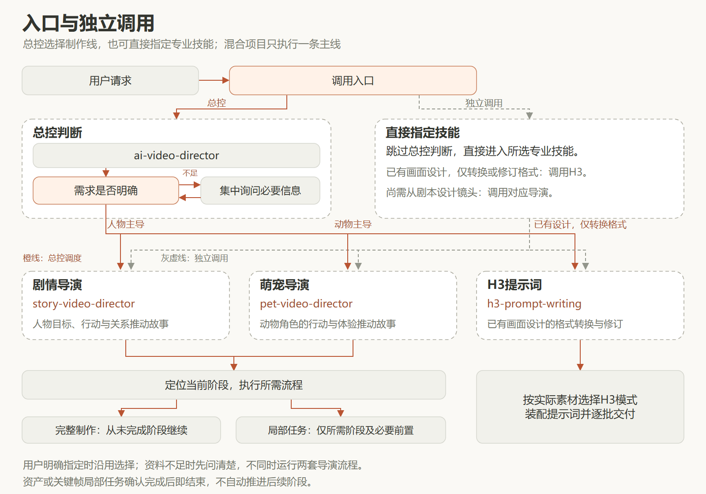
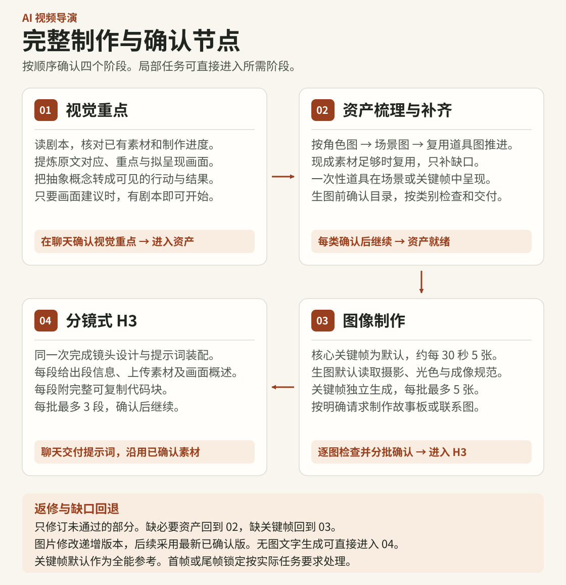
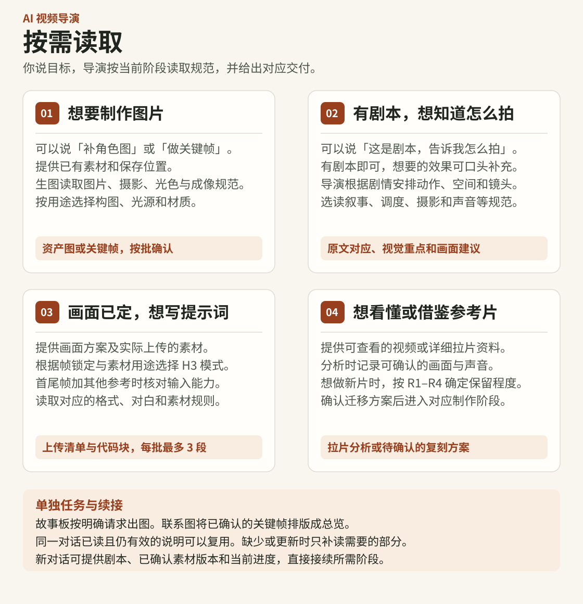
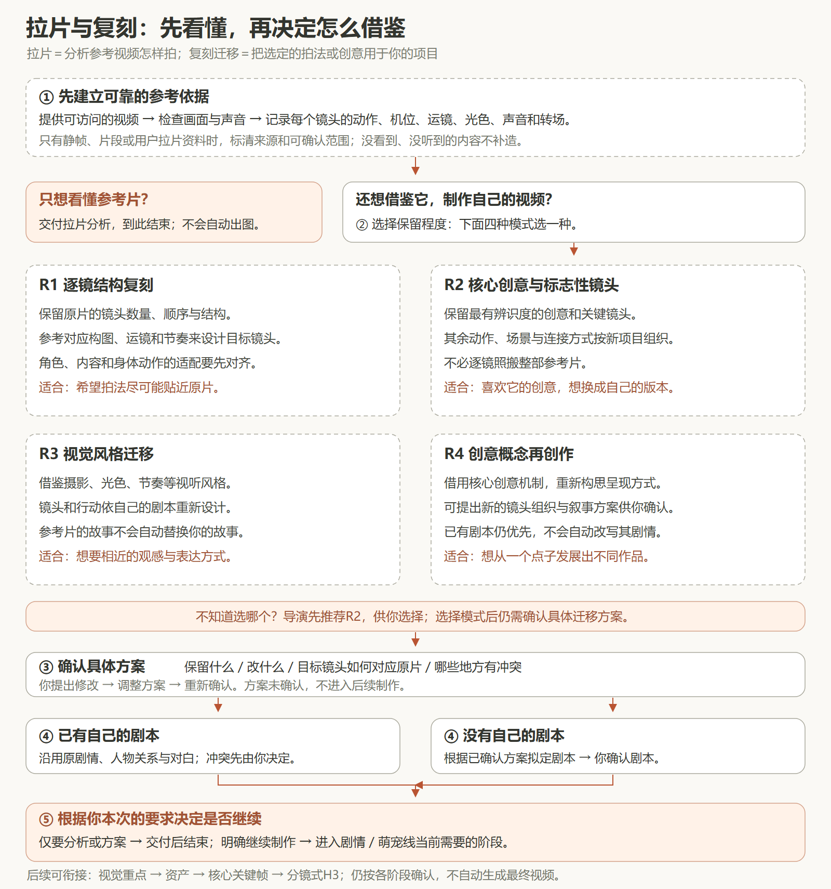

# AI 视频导演

依据剧本组织视觉重点、资产、图像制作和分镜式 MiniMax H3 提示词。支持总控选线推进，也支持专业技能分别调用。

## 能力架构总览

总控与默认制作路线一览。阶段3现为图像制作，包含核心关键帧，以及明确请求时的故事板和联系图。点击图片查看原图。

## 解决什么问题

将剧本、素材和镜头设计衔接成可逐批确认的制作流程，减少重复补图、身份与空间不连续、提示词漏对白及一次读取过多规范的问题。保留原剧情、对白、事件因果和已确认素材版本。

## 主要功能

| 入口 | 职责 |
|---|---|
| $ai-video-director | 判断叙事主线、选择专业技能、衔接当前阶段 |
| $story-video-director | 人物主导的单人、多人、对话与旁白视频设计 |
| $pet-video-director | 动物主导的剧情、体态、表演与摄影适配 |
| $h3-prompt-writing | 独立转换或修订已有画面设计的H3提示词 |

两条导演线共用四阶段：

1. **视觉重点**：提炼原文、信息重点与画面建议，在聊天中确认。
2. **资产**：按角色、场景、必要复用道具的顺序补缺并分别确认；现成素材足够则复用，一次性道具不单独建图。
3. **图像制作**：默认优先制作供全能参考的独立核心关键帧，每批最多5张，以约每30秒5张为参考。按明确请求交付叙事故事板，或用已确认关键帧排成联系图。
4. **分镜式H3**：同一次任务完成镜头设计和提示词装配，每批最多3段，确认后继续；不另设必须先审批的中文分镜稿。

默认文字在聊天中交付，图片保存至用户指定目录。修改图递增版本，后续采用最新已确认版本。H3正文默认中文，用户指定其他语言时采用指定语言，原台词及固定字段保持原样。

导演按剧本设计[拍摄方式](references/storyboard-direction.md#拍摄方式)。你可以直接描述想要的效果，例如「像猫亲眼看到的一样」或「像在看电脑屏幕，线索从聊天窗口里出现」。拉片和 R1–R4 复刻迁移仅在明确请求时执行。项目默认不生成最终视频，静态检查不能代替成片声画验证。

## 制作流程图

视觉重点 → 资产补齐 → 图像制作（默认核心关键帧） → 分镜式H3。各阶段按规定批次确认后继续。

### 入口与独立调用

总控根据叙事主导者选线，用户明确指定时沿用选择；混合项目只执行一条主线。只给剧本、仍需设计镜头时交给导演；已有画面设计的格式转换可直接调用H3。资产或图像局部任务完成并确认后即结束，不自动进入后续阶段。

### 完整制作与确认节点

### 按需读取：从你想做什么开始

“按需读取”就是只查看当前这一步需要的操作说明。你只需说明目标、已有素材和当前进度，导演负责选择图片制作、镜头设计、H3装配、视频分析、叙事故事板或联系图能力。

### 拉片与复刻：模式选择及确认流程

拉片用于看懂参考视频怎样拍；复刻迁移用于把选定的拍法或创意用到自己的项目。R1保留逐镜结构，R2保留核心创意与标志性镜头，R3迁移视觉风格，R4进行创意概念再创作。模式选择后仍需确认具体方案。

可以直接这样提出需求：

~~~text
使用 $ai-video-director，先对这段参考视频做拉片分析，告诉我每个镜头怎样拍。
这次只分析，不制作图片或提示词。
参考视频：<视频附件或可访问的位置>
~~~

~~~text
使用 $pet-video-director，我想借鉴这段视频的核心创意，按R2提出迁移方案。
参考视频：<视频附件或可访问的位置>
我的剧本：<已有剧本；没有则写“无”>
目标主角：<角色设定或参考图>
请先说明保留什么、改什么、镜头如何对应，等我确认方案后再继续。
~~~

已有剧本时保持原剧情与对白；没有剧本时，先确认迁移方案，再确认据此拟定的剧本。只要求分析或方案就到此交付，明确要求继续制作后才进入相应阶段。

## 安装方法

这是供支持本地技能的代理读取的指令文件集合，没有独立安装程序或视频生成服务。

1. **整体保留本目录结构**，放入宿主配置的技能扫描位置，并通过宿主加载所需入口。三个专业技能可分别调用，均依赖本包参考文件，不支持只复制子技能文件夹安装。
2. 若宿主尚未列出入口，可直接提供本包内相应 SKILL.md 的路径，让代理读取。总控入口在根目录，专业入口在 skills/ 下。
3. 实际生图需要可用的 imagegen 技能、图像生成工具及文件保存权限。仅分析或编写提示词不需要Python，也不需要MiniMax API密钥。
4. 只有制作联系图时需要Python 3与Pillow。具备这项需求时安装：

~~~shell
python -m pip install Pillow
~~~

主要目录：

~~~text
ai-video-director/
├─ SKILL.md                       总控
├─ agents/                        总控界面元数据
├─ assets/                        README架构与制作流程图
├─ skills/
│  ├─ story-video-director/        剧情导演及其元数据
│  ├─ pet-video-director/          萌宠导演及其元数据
│  └─ h3-prompt-writing/           H3入口、元数据与语法参考
├─ references/                    制作流程、图片、导演与按需规范
├─ scripts/make_contact_sheet.py  可选联系图工具
└─ LICENSE
~~~

## 使用方法

第一次用可以直接贴剧本，发一句「使用 $ai-video-director。这是我的剧本，先告诉我怎么拍。」想强调某个效果时，用日常话说明即可，比如「我想让最后的反转更有冲击力」。

需要推进完整制作时，可一并提供项目资料。

~~~text
使用 $ai-video-director。
剧本：<剧本文件路径，或直接粘贴全文>
已有素材：<素材目录，或“无”>
图片输出目录：<指定目录>
预计时长：30秒
画幅：16:9
请从当前未完成阶段推进，并按规定批次与我确认。
~~~

明确制作线时可直接调用剧情导演或萌宠导演。混合出镜按叙事主导者选择一条主线；资料不足或无法判断时先确认。

局部任务示例：

~~~text
使用 $pet-video-director，仅补齐角色资产图，已有外观设定和参考见附件。
~~~

~~~text
使用 $story-video-director，仅根据这份剧本直接设计分镜式H3，采用无图文字生成，不补做图片。
~~~

~~~text
使用 $h3-prompt-writing，将已确认的画面设计和素材转为中文Ref2VA提示词，先输出前三段。
~~~

只给剧本、尚需设计镜头时交给对应导演；画面设计已清楚、只需格式转换时可以直接使用H3入口。新对话续接项目时附上剧本、已确认素材版本、当前阶段和待确认项。

生成或修改图片时默认读取摄影、光色与成像规范，并将本图的构图、光源、层次和材质写进生图提示词。其他规范按当前阶段读取，已读且仍有效的内容复用。

## 输入输出示例

以下仅展示格式，不代表已经生成图片或验证成片。

**输入：**

~~~text
使用 $pet-video-director。
剧本：小白猫听见门铃，停下玩球，走到门口；发现主人回家，蹭主人的腿。
已有素材：猫、主人和玄关的图片均已确认。
小球仅在开头出现一次。
图片输出目录：<项目图片目录>
预计时长：30秒。
~~~

**阶段1聊天输出示意：**

~~~text
原文对应：听见门铃，停下玩球，走到门口。
重点：门铃吸引注意，猫从玩耍转向门口。
拟呈现画面：耳尖转向声源，前爪停住，视线移向门口，再起身走过去。
~~~

确认后检查已有素材，仅补确有缺口的资产；小球不单独建道具图。关键帧按实际覆盖需求选取，不按镜头数逐一出图。图片文件可能使用：

~~~text
<项目图片目录>/
├─ KF_001_v01.png
└─ KF_002_v01.png
~~~

第四阶段每段包含段信息、必要镜头映射、实际上传素材、简短画面概述和一个完整H3代码块。全能参考采用六字段，基础模式采用三字段，具体格式见[H3技能](skills/h3-prompt-writing/SKILL.md)。待确认的新图不会替换旧的已确认版本。

规范入口：[制作流程](references/production-workflow.md)、[图片标准](references/image-standards.md)、[分镜导演](references/storyboard-direction.md)、[按需能力](references/optional-workflows.md)。
