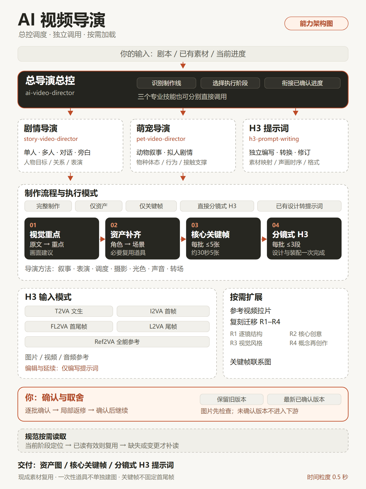
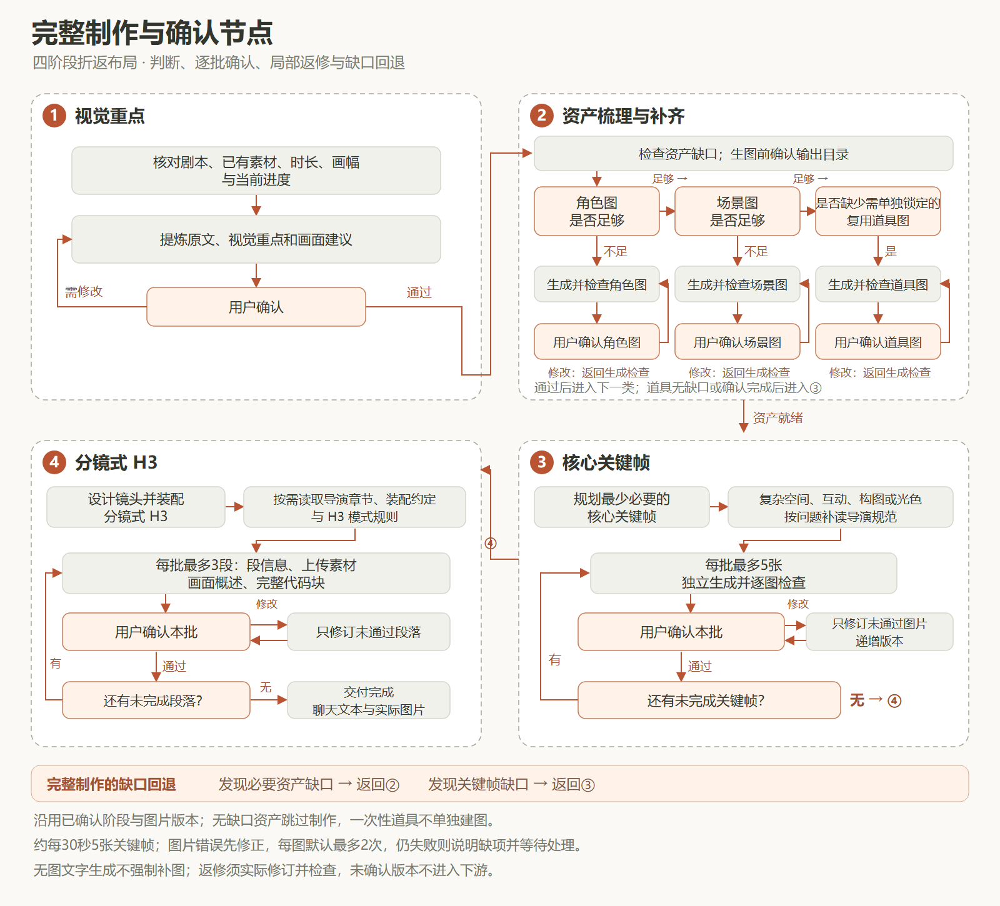

# AI 视频导演

依据剧本组织视觉重点、资产、核心关键帧和分镜式 MiniMax H3 提示词。支持总控选线推进，也支持专业技能分别调用。

## 能力架构总览

总控、技能、模式与能力一览。点击图片查看原图。

## 解决什么问题

将剧本、素材和镜头设计衔接成可逐批确认的制作流程，减少重复补图、身份与空间不连续、提示词漏对白及一次读取过多规范的问题。保留原剧情、对白、事件因果和已确认素材版本。

## 主要功能

| 入口 | 职责 |
|---|---|
| $ai-video-director | 判断叙事主线、选择专业技能、衔接当前阶段 |
| $story-video-director | 人物主导的单人、多人、对话与旁白视频设计 |
| $pet-video-director | 动物主导的剧情、体态、表演与摄影适配 |
| $h3-prompt-writing | 独立转换或修订已有画面设计的H3提示词 |

两条导演线共用四阶段：

1. **视觉重点**：提炼原文、信息重点与画面建议，在聊天中确认。
2. **资产**：按角色、场景、必要复用道具的顺序补缺并分别确认；现成素材足够则复用，一次性道具不单独建图。
3. **核心关键帧**：供全能参考的独立情境图，每批最多5张；约每30秒5张是效率参考，不强制凑数或锁定首尾帧。
4. **分镜式H3**：同一次任务完成镜头设计和提示词装配，每批最多3段，确认后继续；不另设必须先审批的中文分镜稿。

默认文字在聊天中交付，图片保存至用户指定目录。修改图递增版本，后续采用最新已确认版本。输出语言服从用户明确要求，否则跟随本轮请求；H3字段、标签和固定枚举保持原样。

拉片、R1–R4复刻迁移和关键帧联系图仅在明确请求时执行。项目默认不生成最终视频，静态检查不能代替成片声画验证。

## 制作流程图

视觉重点 → 资产补齐 → 核心关键帧 → 分镜式H3。各阶段按规定批次确认后继续。

### 入口与独立调用

~~~mermaid
flowchart TD
    U["用户请求"] --> E{"调用入口"}
    E -->|"总控"| C["ai-video-director"]
    E -->|"独立调用"| S["story-video-director"]
    E -->|"独立调用"| P["pet-video-director"]
    E -->|"独立调用"| H["h3-prompt-writing"]
    C --> T{"需求是否明确"}
    T -->|"信息不足"| Q["集中询问必要信息"]
    Q --> T
    T -->|"人物主导"| S
    T -->|"动物主导"| P
    T -->|"已有画面设计，仅转换格式"| H
    S --> W["定位当前阶段，执行所需流程"]
    P --> W
    W --> F["完整制作：从未完成阶段继续"]
    W --> L["局部任务：仅执行所需阶段及必要前置"]
    H --> HF["按实际素材选模式，装配并逐批交付"]
~~~

总控根据叙事主导者选线，用户明确指定时沿用选择；混合项目只执行一条主线。只给剧本、仍需设计镜头时交给导演；已有画面设计的格式转换可直接调用H3。资产或关键帧局部任务完成并确认后即结束，不自动进入后续阶段。

### 完整制作与确认节点

### 规范的按需读取

~~~mermaid
flowchart LR
    A["当前阶段或具体问题"] --> B{"所需规则是否已读、仍在上下文且未变化"}
    B -->|"是"| C["直接复用"]
    B -->|"否"| D["定位所需文件与章节"]
    D --> E["只补读当前问题需要的内容"]
    E --> C
    C --> F["执行当前任务"]
    F -.->|"图片制作"| I["图片标准及imagegen"]
    F -.->|"空间、摄影、表演或光色问题"| J["分镜索引及相关导演章节"]
    F -.->|"H3装配"| H["对应模式规则；案例按需"]
    F -.->|"明确要求扩展能力"| O["拉片、复刻或联系图"]
~~~

新对话、文件更新或上下文缺失时重新定位所需内容；不假定跨对话永久记忆，也不新增缓存文件。拉片与复刻按方案确认后执行；联系图仅使用已检查、已确认且完整的关键帧集合。

## 安装方法

这是供支持本地技能的代理读取的指令文件集合，没有独立安装程序或视频生成服务。

1. **整体保留本目录结构**，放入宿主配置的技能扫描位置，并通过宿主加载所需入口。三个专业技能可分别调用，但两个导演依赖外层参考文件，不支持只复制子技能文件夹安装。
2. 若宿主尚未列出入口，可直接提供本包内相应 SKILL.md 的路径，让代理读取。总控入口在根目录，专业入口在 skills/ 下。
3. 实际生图需要可用的 imagegen 技能、图像生成工具及文件保存权限。仅分析或编写提示词不需要Python，也不需要MiniMax API密钥。
4. 只有制作联系图时需要Python 3与Pillow。具备这项需求时安装：

~~~shell
python -m pip install Pillow
~~~

主要目录：

~~~text
ai-video-director/
├─ SKILL.md                       总控
├─ agents/                        总控界面元数据
├─ assets/                        README架构与制作流程图
├─ skills/
│  ├─ story-video-director/        剧情导演及其元数据
│  ├─ pet-video-director/          萌宠导演及其元数据
│  └─ h3-prompt-writing/           H3入口、元数据与语法参考
├─ references/                    制作流程、图片、导演与按需规范
├─ scripts/make_contact_sheet.py  可选联系图工具
└─ LICENSE
~~~

## 使用方法

从总控开始，路径替换为自己的项目位置：

~~~text
使用 $ai-video-director。
剧本：<剧本文件路径，或直接粘贴全文>
已有素材：<素材目录，或“无”>
图片输出目录：<指定目录>
预计时长：30秒
画幅：16:9
请从当前未完成阶段推进，并按规定批次与我确认。
~~~

明确制作线时可直接调用剧情导演或萌宠导演。混合出镜按叙事主导者选择一条主线；资料不足或无法判断时先确认。

局部任务示例：

~~~text
使用 $pet-video-director，仅补齐角色资产图，已有外观设定和参考见附件。
~~~

~~~text
使用 $story-video-director，仅根据这份剧本直接设计分镜式H3，采用无图文字生成，不补做图片。
~~~

~~~text
使用 $h3-prompt-writing，将已确认的画面设计和素材转为中文Ref2VA提示词，先输出前三段。
~~~

只给剧本、尚需设计镜头时交给对应导演；画面设计已清楚、只需格式转换时可以直接使用H3入口。新对话续接项目时附上剧本、已确认素材版本、当前阶段和待确认项。

规范按当前阶段和问题读取。同一对话中已读、仍在上下文且未变化的内容复用；新对话、文件更新或上下文缺失时只补读相关部分，不另建缓存文件。

## 输入输出示例

以下仅展示格式，不代表已经生成图片或验证成片。

**输入：**

~~~text
使用 $pet-video-director。
剧本：小白猫听见门铃，停下玩球，走到门口；发现主人回家，蹭主人的腿。
已有素材：猫、主人和玄关的图片均已确认。
小球仅在开头出现一次。
图片输出目录：<项目图片目录>
预计时长：30秒。
~~~

**阶段1聊天输出示意：**

~~~text
原文对应：听见门铃，停下玩球，走到门口。
重点：门铃吸引注意，猫从玩耍转向门口。
拟呈现画面：耳尖转向声源，前爪停住，视线移向门口，再起身走过去。
~~~

确认后检查已有素材，仅补确有缺口的资产；小球不单独建道具图。关键帧按实际覆盖需求选取，不按镜头数逐一出图。图片文件可能使用：

~~~text
<项目图片目录>/
├─ KF_001_v01.png
└─ KF_002_v01.png
~~~

第四阶段每段包含段信息、必要镜头映射、实际上传素材、简短画面概述和一个完整H3代码块。全能参考采用六字段，基础模式采用三字段，具体格式见[H3技能](skills/h3-prompt-writing/SKILL.md)。待确认的新图不会替换旧的已确认版本。

规范入口：[制作流程](references/production-workflow.md)、[图片标准](references/image-standards.md)、[分镜导演](references/storyboard-direction.md)、[按需能力](references/optional-workflows.md)。
